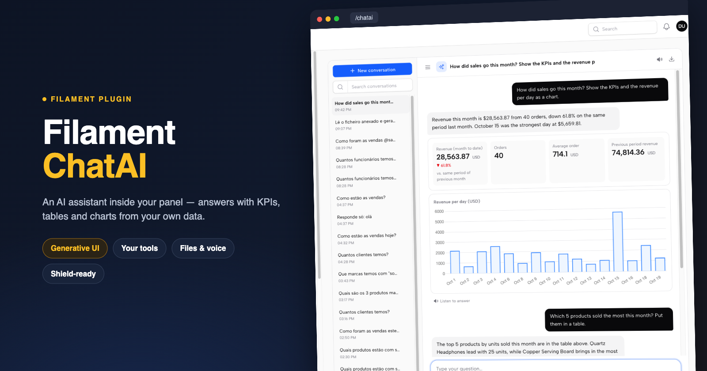
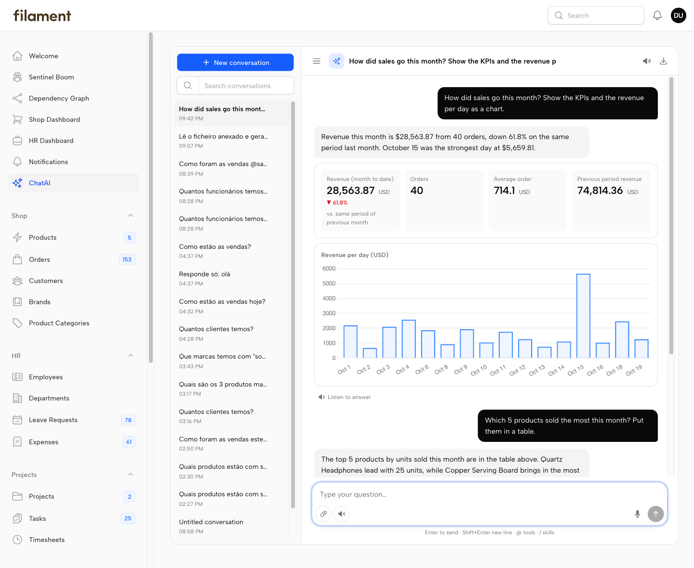
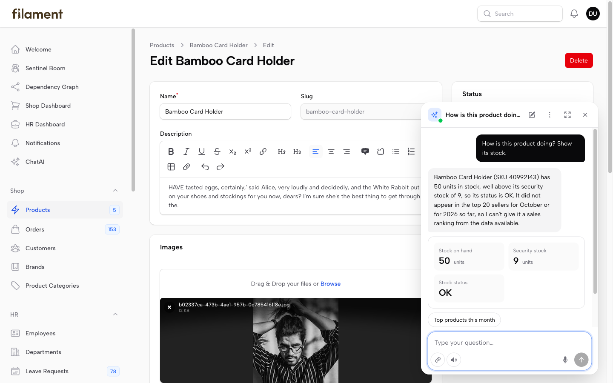
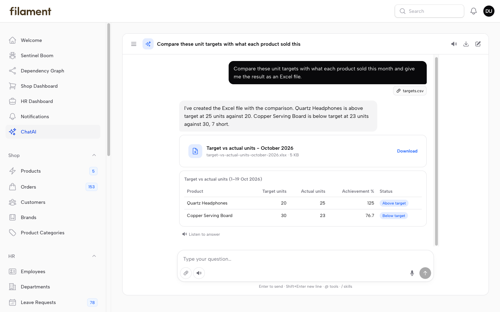
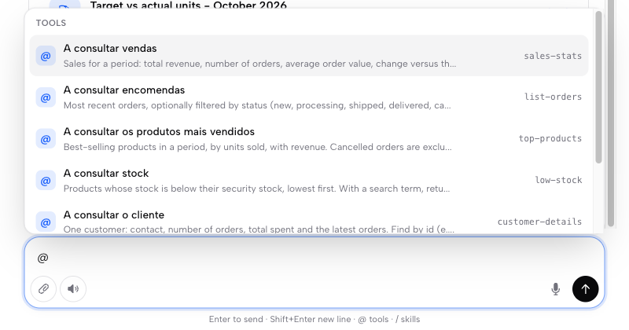
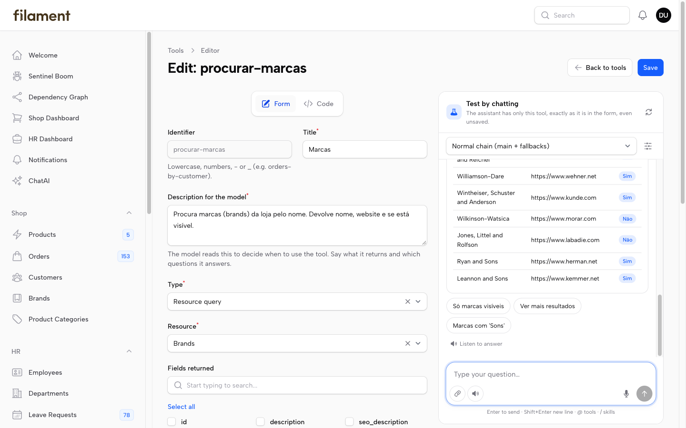
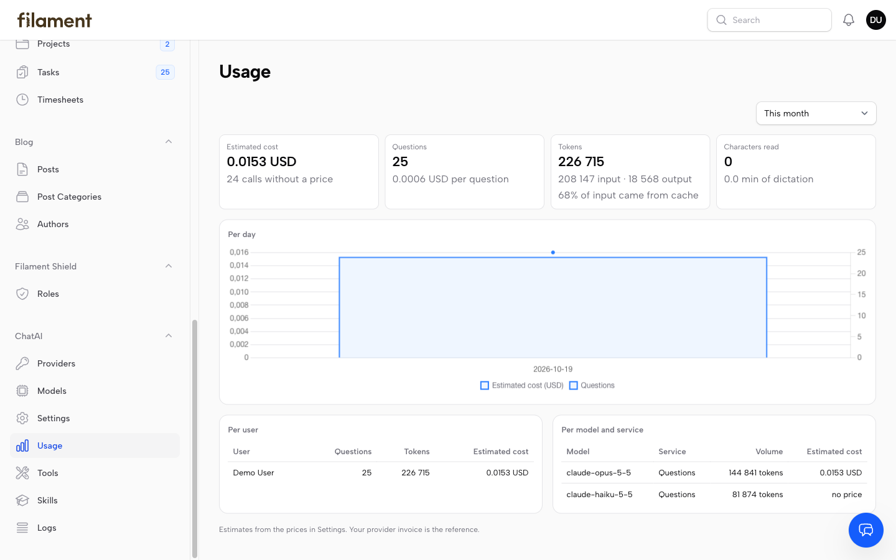
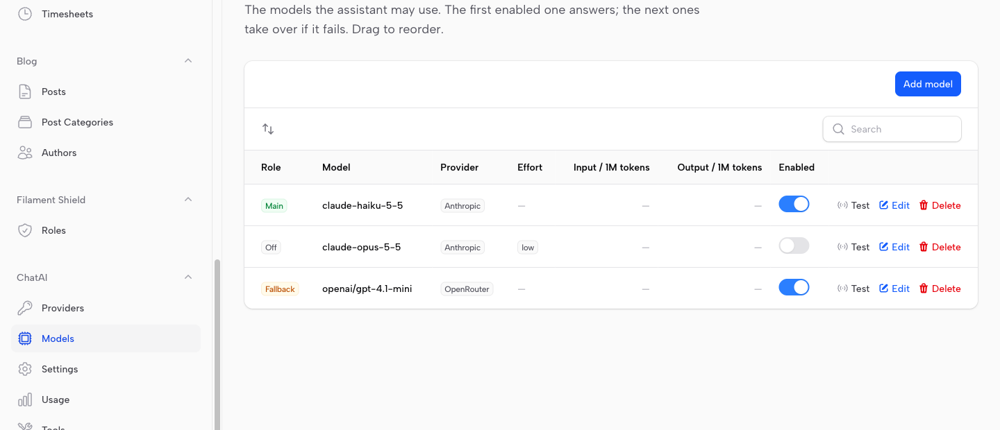
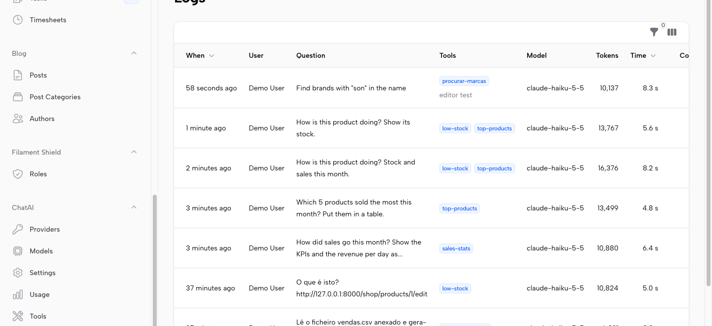
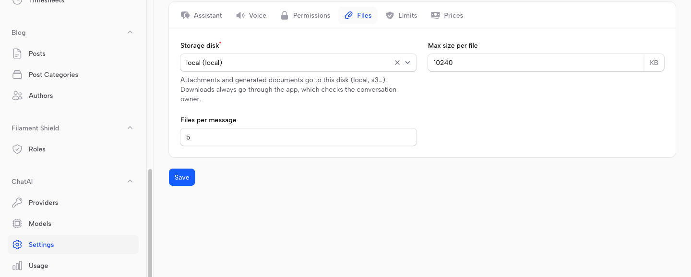

<p align="center">
    
</p>

<h1 align="center">Filament ChatAI</h1>

<p align="center">
    An AI assistant inside your Filament panel — it answers with KPIs, tables and charts from your own data.
</p>

<p align="center">
    
    
    
    
    
</p>

---

- **Floating chat** in the corner of every page, aware of the record on screen.
- **Full-page chat** (`/{panel}/chatai`) with conversation history — the same conversation as the floating one.
- **Generative UI**: the model answers with KPIs, sortable tables, Filament-styled charts and follow-up suggestions, not just text.
- **Your tools**: plug in existing `laravel/mcp` tools, or build tools on screen (Resource queries, HTTP APIs) and test them in a chat next to the form. Read-only, for now.
- **Files**: attach documents, paste links to records of the panel, and get CSV, Excel or PDF files back.
- **Voice and export**: dictate, hear answers read aloud, export a conversation to Markdown.
- **Control**: models with fallbacks, several provider keys with spending limits, usage and cost per user and model, a log of every question, and Filament Shield permissions per tool.
- **Providers**: any OpenAI-compatible endpoint (OpenAI, OpenRouter, Ollama) or Claude natively through `anthropic-ai/sdk`.

## Screenshots

#### Full-page chat — history, KPIs and charts from the shop data



#### Floating chat — knows the record on screen



<table>
<tr>
<td width="50%"><br><em>Attach a file, get an Excel back</em></td>
<td width="50%"><br><em><code>@</code> picks a tool, <code>/</code> applies a skill</em></td>
</tr>
</table>

#### Tool editor — build a tool on screen and test it by chatting



#### Usage — cost, tokens and cache, per user and per model



<table>
<tr>
<td width="50%"><br><em>Models — the first enabled answers, the next take over</em></td>
<td width="50%"><br><em>Logs — question, tools, model, tokens and time</em></td>
</tr>
<tr>
<td width="50%"><br><em>Settings — assistant, voice, permissions, files, limits, prices</em></td>
<td width="50%"></td>
</tr>
</table>

## Install

```bash
composer require anselmokossa/filament-chatai
php artisan vendor:publish --tag=chatai-migrations && php artisan migrate
php artisan filament:assets
```

```php
use Filament\ChatAi\ChatAiPlugin;
use Filament\ChatAi\Tools\LaravelMcpToolProvider;

$panel->plugins([
    ChatAiPlugin::make()
        ->label('Assistant')
        ->tools(fn () => new LaravelMcpToolProvider([
            \App\Mcp\Tools\SalesStatsTool::class,
            \App\Mcp\Tools\LowStockTool::class,
        ]))
        ->canAccess(fn ($user) => $user->can('use-assistant')),
]);
```

## Set it up on screen

Everything is configured in the panel, under the **ChatAI** menu. No `.env` editing is needed.
The admin pages are closed until you say who may open them (they hold API keys):

```php
ChatAiPlugin::make()->canManageSettings(fn ($user) => $user->is_admin)
```

| Page | What you set |
|---|---|
| **Providers** | Each account/endpoint with its own key (encrypted): Anthropic, OpenRouter, OpenAI, a local Ollama… Monthly and daily **spending limits** per provider. |
| **Models** | The models in order: the first enabled one answers, the next ones take over if it fails (any number of providers). Effort and price per model. "Test" per model. |
| **Settings** | Assistant instructions and allowed API hosts · Voice (browser, Azure or Google, keys, voices users may pick) · Limits (messages per user, tool steps, timeout) · Currency and voice prices. |
| **Usage** | Estimated cost, questions, tokens (with the share served from prompt cache), voice, per day, user and model. |
| **Tools** | Adjust code tools (on/off, wording, profiles) and build new ones without code: query a panel resource, or call an allowed GET API. Full-page editor with a live test chat and the tool as JSON / cURL / laravel/mcp code. |
| **Skills** | Saved instructions for a kind of task, linked to the tools to use. |
| **Logs** | Every question: who, tools used, tokens, time and cost. |

Claude requests use prompt caching automatically: system prompt, tools and history are billed at the
cache-read price on every tool round and follow-up question.

## Filament Shield

Turn on **Settings → Permissions** and each tool needs its own permission, named like Shield's own
(`UseChatAiTool:SalesStats`); using the chat can also require `UseChatAi`. They show up in Shield's roles
editor, **Custom permissions** tab (enable `shield_resource.tabs.custom_permissions`), so you tick per role
who may use what. A user without a tool's permission does not get that tool, so the assistant tells them it
has no access to that data. A tool can require an existing permission instead (e.g. `ViewAny:Order`).
Resource tools also follow the resource's policies, and Shield's super admin always passes.

## Files

- **Attach** with the paperclip, by dropping files on the box or pasting an image. Images and PDF go to the model as they are; text, CSV, JSON and Excel go as text.
- **Links** to records of this panel pasted in the question are recognised: the assistant is told which resource and record they point to.
- **Documents**: the `create_document` tool makes CSV, Excel, Markdown, HTML, text or PDF (PDF needs `dompdf/dompdf`). The user gets a download card; only the conversation owner can download.
- Where files are kept (`local`, `s3`, any disk in `config/filesystems.php`), the size limit and files per message are set in **Settings → Files**, or with `->filesDisk('s3')` on the plugin.

## Optional: `.env` defaults

Handy on servers or CI. A provider saved on screen without a key uses these; values saved on screen win.

```dotenv
ANTHROPIC_API_KEY=...                  # Claude (composer require anthropic-ai/sdk)
CHATAI_API_KEY=...                     # OpenAI-compatible
CHATAI_BASE_URL=https://openrouter.ai/api/v1

CHATAI_SPEECH_PROVIDER=azure           # or google
AZURE_SPEECH_KEY=...
AZURE_SPEECH_REGION=westeurope
```

On first visit, the Providers and Models pages import whatever is set here, so nothing is typed twice.
At runtime a panel or tenant can still override the model (`->llm(fn () => new LlmConfig(...))`) and the
voice (`->speech(fn () => new AzureSpeech(...))`).

## How it works

`POST /{panel}/chatai/api/conversations/{id}/messages` streams server-sent events:
`delta`, `tool_start`, `tool_end`, `component`, `done`, `error`. The model renders UI by calling the
internal `show_ui` tool. Every component is validated server-side (`Ui\ComponentValidator`) before it reaches
the browser. The catalog lives in `Ui\Catalog`, and it is the contract any client (web, mobile) renders.

Each answered question fires `Filament\ChatAi\Events\TurnCompleted` (model, tokens, latency, tools used),
which you can use for usage logs or quotas.

## Test

```bash
composer test
```

Use `Filament\ChatAi\Testing\FakeLlmClient::script([...])` to script the model in your own tests.
